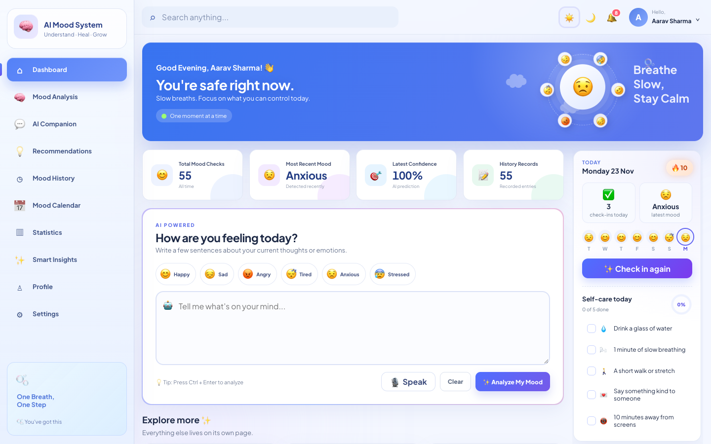
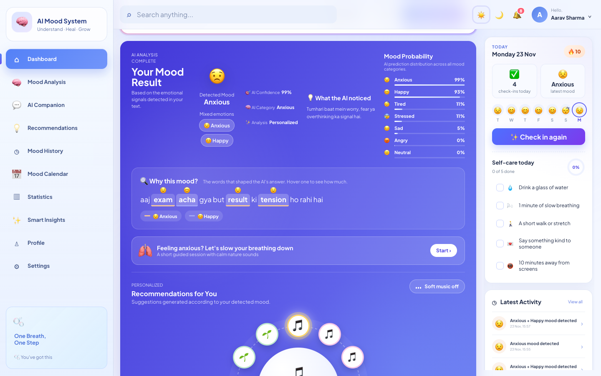
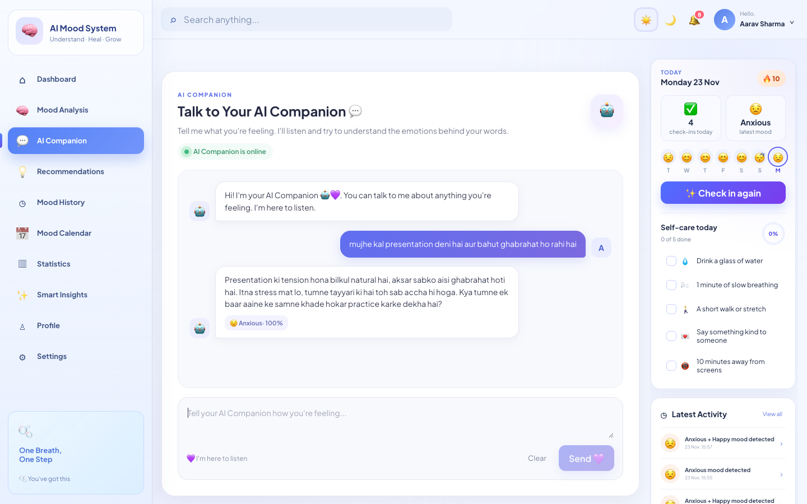
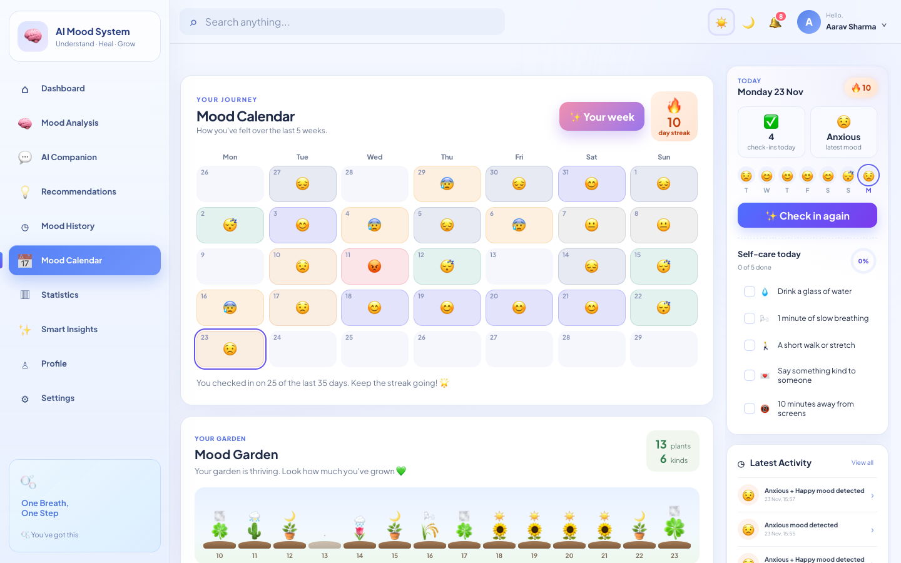
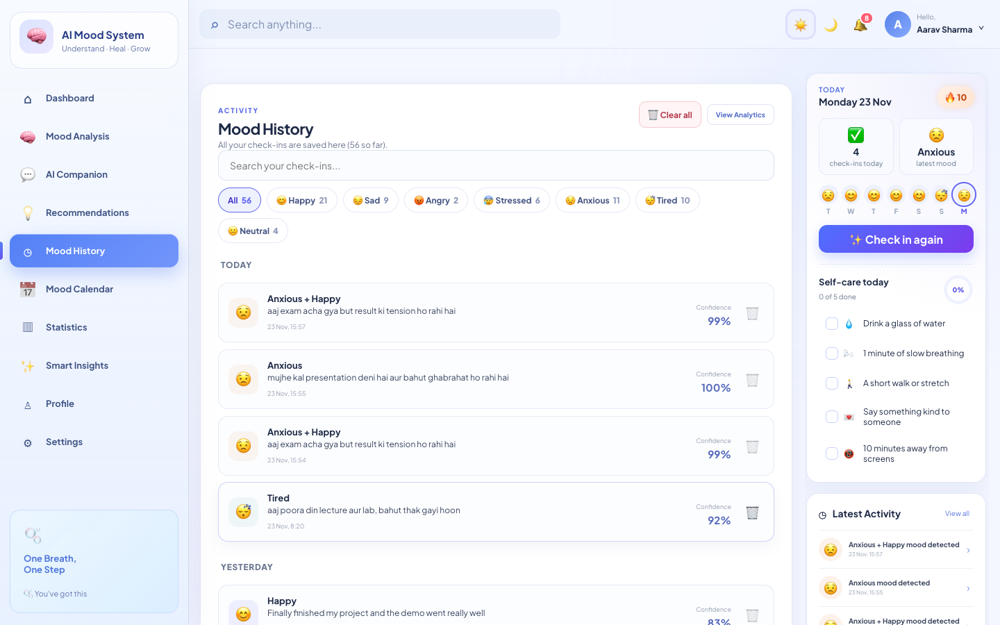
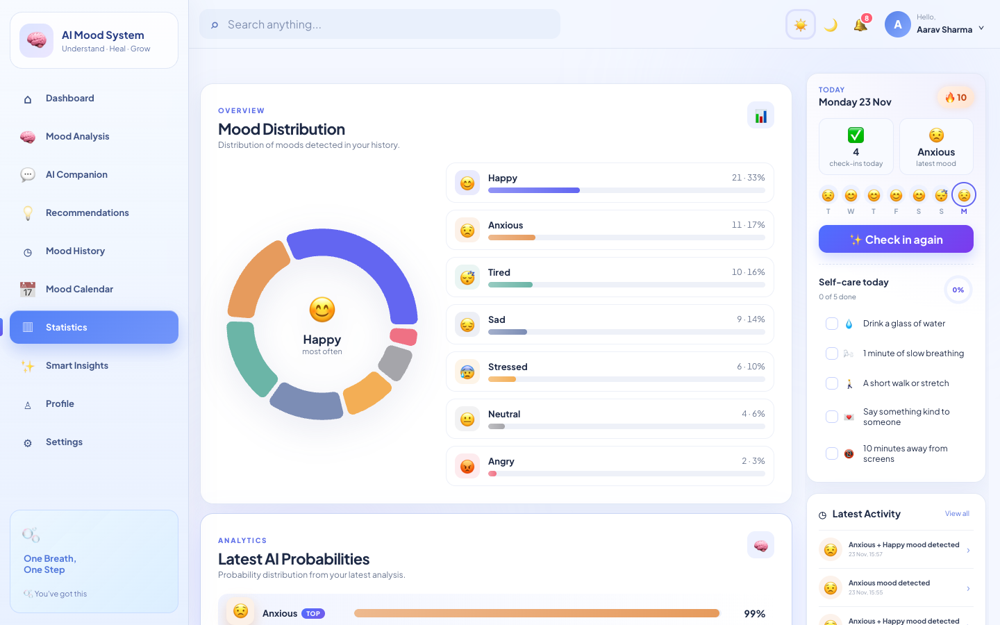
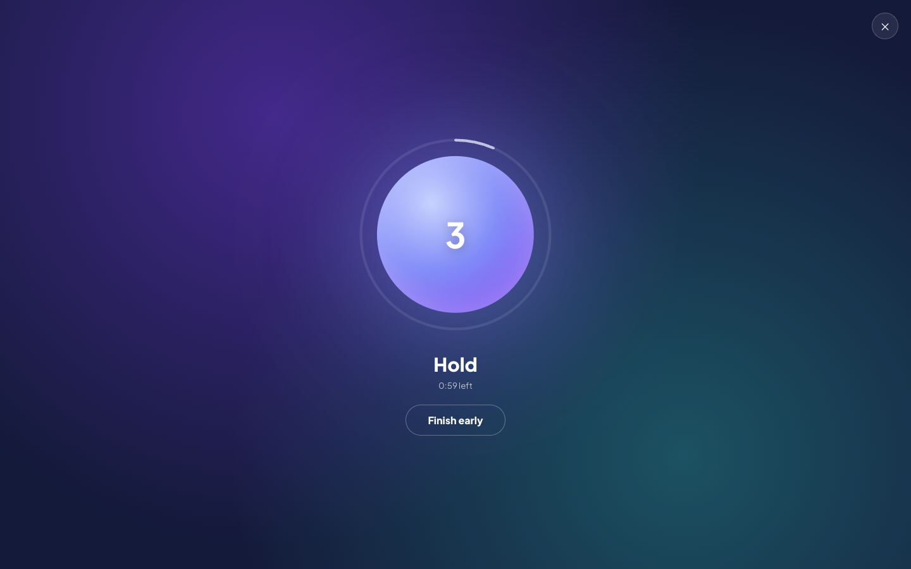
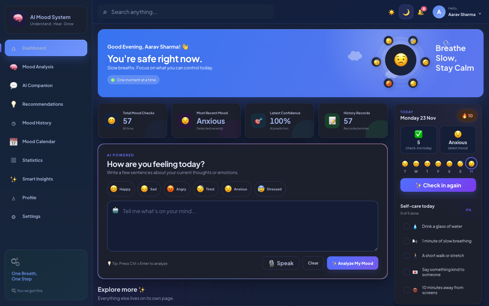
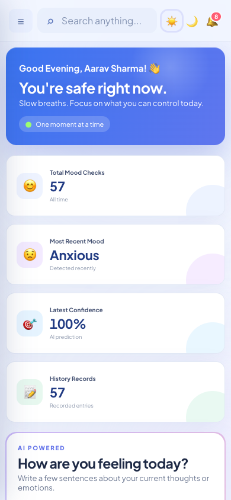
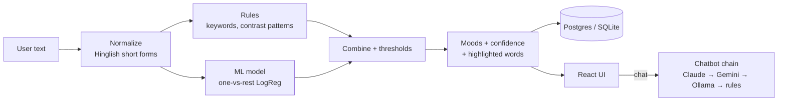

# 🧠 AI Mood System

Apne mann ki baat likho (English, Hindi ya Hinglish) — system samajhta hai ki tum kaisa feel kar rahe ho, **kyun** aisa laga, aur phir tumhe recommendations, breathing exercises, calming sounds aur ek AI companion deta hai.

**Live:** https://ai-mood-system.vercel.app  ·  **API:** https://ai-mood-system.onrender.com/docs

> ⏳ Backend free hosting par hai: 15 min idle rehne par so jata hai, pehla request 30–60 sec le sakta hai.

| Dashboard | Mood result + "Why this mood?" |
|---|---|
|  |  |
| **AI Companion** | **Mood calendar + garden** |
|  |  |
| **History (search + filters)** | **Statistics** |
|  |  |
| **Guided breathing** | **Dark mode** |
|  |  |

<p align="center"></p>

## Features

- **Multi-mood detection** — ek sentence me kai moods ("exam acha gaya but result ki tension hai" → Anxious + Happy). 7 moods: happy, sad, angry, stressed, anxious, tired, neutral.
- **Why this mood?** — jo words mood ko sabse zyada push karte hain, highlight hote hain.
- **AI Companion** — Claude → Gemini → local Ollama → rule-based replies (jo pehla available ho). Hinglish me reply, crisis words par helpline (Tele-MANAS 14416, emergency 112).
- **Mood history** — search, mood filters, purani entries tak paging, delete.
- **Calendar, streak, Mood Garden** — har din ka mood ek plant ban jata hai.
- **Statistics & Smart Insights** — trends, donut chart, weekly view.
- **Breathing sessions** + **soundscapes** (ocean, rain, forest, bowls, fire… Web Audio se generate hote hain, koi audio file nahi).
- **Daily affirmation, "little good thing", notifications, self-care checklist.**
- **Light + dark theme**, mobile friendly, voice input (Speak).

## Kaise kaam karta hai



- **Model:** TF-IDF (word + char) + multilingual MiniLM sentence embeddings → One-vs-Rest Logistic Regression. ~18k training sentences (hand-written patterns + augmentation, `backend/build_multilabel_dataset.py`).
- **Rules + ML:** rules saaf cases pakadte hain, ML baaki ko; kam confidence par result *Neutral* hota hai.
- **Do versions:** *full* (embeddings, ~550 MB RAM) aur *light* (bina torch, ~340 MB, Render free tier par chalta hai — `MOOD_MODEL=light`).

### Accuracy (imandari se)

55 alag hand-written sentences par (training me nahi the):

| Model | Saare moods sahi | Main mood sahi |
|---|---|---|
| Full | ~71% | ~85% |
| Light (live) | ~60% | ~75% |

Hinglish aur mixed feelings abhi bhi kabhi galat padte hain. Galat result mile to `backend/mood_phrase_bank.py` me pattern add karke dobara train kar sakte ho.

## Tech stack

- **Frontend:** React 19, Vite, Recharts, plain CSS (light + dark)
- **Backend:** FastAPI, SQLAlchemy, JWT auth (argon2), scikit-learn, sentence-transformers (full model)
- **DB:** SQLite (local), Postgres (Neon / Supabase)
- **AI chat:** Anthropic Claude, Google Gemini (auto model discovery), Ollama
- **Hosting:** Vercel (frontend), Render (backend, Docker)

## Project structure

```
backend/
  main.py                  FastAPI app
  app/routers/             auth, mood, history, dashboard, chatbot, recommendations
  app/services/            mood_ai.py, mood_explain.py, gemini_chat.py, gemini_models.py
  build_multilabel_dataset.py, train_multilabel_model.py, evaluate_mood_model.py
  Dockerfile (light) · Dockerfile.full
  tests/
frontend/src/              App.jsx, polish.css, dark.css, ambientMusic.js
docs/screenshots/
```

## Laptop par chalana

Chahiye: Python 3.11+, Node 20+.

```bash
# backend
cd backend
python -m venv venv && source venv/bin/activate
pip install -r requirements.txt
uvicorn main:app --reload --port 8000
```

```bash
# frontend (naye terminal me)
cd frontend
npm install
npm run dev
```

Browser me http://localhost:5173 kholo. Frontend default me `http://127.0.0.1:8000` se baat karta hai; badalna ho to `VITE_API_URL` set karo.

### Environment variables (`backend/.env`)

| Variable | Matlab |
|---|---|
| `DEBUG` | `false` production me (tab `JWT_SECRET_KEY` zaroori) |
| `DATABASE_URL` | default SQLite; Postgres URL bhi chalta hai |
| `JWT_SECRET_KEY` | lamba random secret |
| `CORS_ORIGINS` | comma-separated frontend URLs |
| `GEMINI_API_KEY`, `GEMINI_MODEL` | free chatbot ([AI Studio](https://aistudio.google.com/apikey)); model retire ho to khud naya dhoondhta hai |
| `ANTHROPIC_API_KEY` | optional, Claude replies |
| `OLLAMA_URL`, `OLLAMA_MODEL` | optional local model |
| `MOOD_MODEL` | `light` ya `full` |

Gemini key set + test karne ka aasaan tarika: `cd backend && venv/bin/python set_gemini_key.py` (key chat/git me kabhi mat daalo; `.env` gitignored hai).

### Model dobara train karna

```bash
cd backend
venv/bin/python build_multilabel_dataset.py
venv/bin/python train_multilabel_model.py                 # full
venv/bin/python train_multilabel_model.py --no-embeddings # light
venv/bin/python evaluate_mood_model.py
```

### Tests

```bash
cd backend
venv/bin/python -m unittest tests.test_gemini_models tests.test_set_gemini_key tests.test_gemini_chat
```

## Deploy

- **Backend (Render):** Docker, root `backend/`, env `MOOD_MODEL=light`, `DEBUG=false`, `JWT_SECRET_KEY`, `DATABASE_URL`, `CORS_ORIGINS`, `GEMINI_API_KEY`. Health check: `/health`. Bade host par `Dockerfile.full` use karo.
- **Frontend (Vercel):** root `frontend/`, env `VITE_API_URL=<backend url>`. Note: Vercel commit author ko GitHub account se match karta hai.

## Limitations & privacy

- Ye **medical ya diagnosis tool nahi hai**. Zyada pareshaan ho to kisi apne ya professional se baat karo. India: Tele-MANAS **14416**, emergency **112**.
- Chat messages Gemini/Claude ko bheje jate hain; Google ki free tier ka data unke product improvement me use ho sakta hai.
- Free hosting: backend so jata hai, chat kabhi slow ya rule-based fallback par ho sakti hai.

## Roadmap

UptimeRobot ping (`/health`), mood journal + reminders, trigger tracking, `App.jsx` ko chhote components me todna, mood model ke liye aur data.
